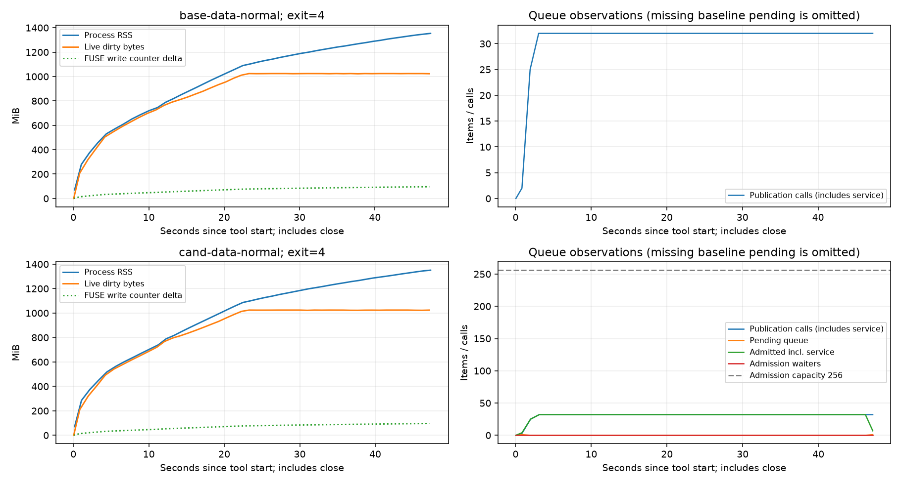

# Issue #391：单对象放大与元数据提交背压

状态：未达到合并条件，[PR #408](https://github.com/brewfs/brewfs/pull/408)
保持 draft。基线为 `1bd4d75`，全部数据来自本轮冻结的 release 二进制；
没有把失败的压力运行当作成功的吞吐基线。对象载荷已满足目标，本地队列容量
测试通过；规定 fio 压力在候选上仍报 EIO，而且未触发容量等待，端到端问题未解决。

## 修改前的两张表

两张初始表于 2026-11-02 11:26 UTC 固化，产品实现仍未修改。完整实验产物位于
`/data/out/issue391/`，独立报告为 `/data/out/REPORT-391-REST.md`。
以下将相同结果的 direct/buffered、聚合开关单元合并显示；四个独立文件单元和
四个稀疏写单元均分别运行并校验。

| 工作负载 | direct | 聚合 | logical B | PUT B | PUT 数 / 新对象数 | avg PUT B | 字节放大 | PUT/GiB |
| --- | --- | --- | ---: | ---: | ---: | ---: | ---: | ---: |
| 256 个独立 4 KiB 文件 | 0、1 | off、on | 1,048,576 | 1,049,600 | 256 / 256 | 4,100 | 1.000977x | 262,144 |
| 8192 次间隔 64 KiB 的 4 KiB 写 | 0、1 | off | 33,554,432 | 33,587,200 | 8192 / 8192 | 4,100 | 1.000977x | 262,144 |
| 同上 | 0、1 | on，64 KiB | 33,554,432 | 34,013,184 | 512 / 512 | 66,432 | 1.013672x | 16,384 |

PUT 字节为成功逻辑上传的 S3 对象载荷，不含 HTTP/TLS 或 SDK 内部重试的线上
字节。PUT 计数器的增量与 S3 对象清单的
数量、长度完全一致。全部已写页 SHA-256 和间隔零洞均通过读回验证。独立文件
逐个 fsync/close，不通过等待其他文件来制造聚合收益。

当前单对象已低于 2x，无需修改对象格式。4100 = 4096 + 4；四字节是
`chunks-v2` 的持久化格式头，无页对齐补零。删掉它需要新格式及兼容策略，收益
仅 0.098%。聚合对象长度恰为 `16*(4096+4)+64+16*48=66432`，保持 #404
的 16,384 PUT/GiB。新增回归测试覆盖 64 KiB 缓存页上的独立 4 KiB 写、聚合
开关、实际对象长度和读回。

RustFS 1.0.4 的本地分配不同于上传载荷：诊断单元
`base-single-physical-r2` 中，256 个新 `xl.meta` 文件各为 4684 字节，实际占
8192 字节；每个对象键另建两个各占 4096 字节的目录。因此对象对应的主机
分配为 16 KiB / 4 KiB = 4x，其中包含 584 字节 RustFS 包装和文件系统块/目录
粒度。整个 volume 的 du 增量还含控制及预检文件，不能替代精确 PUT 字节。
即使省掉 BrewFS 的四字节头，`xl.meta` 仍为 4680 字节，依然需要两个数据块和
两个目录；该物理分配不会因此下降。

| workspace-v1 Redis 压力 | 成功逻辑 MiB | fio MiB/s | fio p99 ms | outstanding 峰值 / pending 代理范围 | RSS 首 / 峰 / 尾 MiB | 提交均值 / p99 ms | 结果 |
| --- | ---: | ---: | ---: | --- | --- | --- | --- |
| 60 s，正常 | 96.398 | 2.051 | 775.946 | 32 / [0,32] | 70.043 / 1355.434 / 1355.434 | 不可用 | fio EIO，exit 4 |
| 60 s，周期性 Redis 停顿 | 70.840 | 1.176 | 9596.568 | 32 / [0,32] | 70.227 / 1080.289 / 1080.289 | 不可用 | 严格 drain 超时，exit 1 |
| 5 s，正常 tracing 诊断 | 33.348 | 6.662 | 122.159 | 32 / [0,32] | 70.836 / 544.125 / 544.125 | 87.634 / 543.003 | exit 0，8446 个 span |
| 5 s，Redis 停顿 tracing 诊断 | 46.203 | 9.224 | 421.528 | 32 / [0,32] | 70.402 / 735.605 / 735.605 | 1088.917 / 3530.029 | drain 超时，11152 个 span |
| 5 s，packed lower + TiKV | 38.305 | 7.647 | 196.084 | 32 / [0,32] | 80.828 / 642.488 / 642.488 | 不可用 | close 300 s 超时；drain 观测缺字段，exit 1 |

fio 为 4 jobs、iodepth 32、4 KiB randwrite、direct=1、512 MiB/job。
请求每 0.5 秒采样，快照开销使实际间隔更长。原实现没有 pending Vec 指标；
outstanding 包括校验、排队和执行中的调用，`[max(0,N-64),N]` 只是代理范围，
不能作为精确队列长度。fio 字节也不代表已持久化成功；失败压力组没有读回完整
验证，不能宣称无丢数据。原源码中的 Vec 无容量限制，64 只是单批上限。新增的
持有 mutation gate 暂停提交的测试直接测得旧实现 512 个调用入队 512 项，
容量断言失败；修复后同样
调用入队 256 项，另外 256 个等待容量。初次定向验证 9 个 group-commit 相关
测试及独立 4 KiB 对象测试均零失败。随后本轮完整门禁也全部通过，详见下文。

原请求直方图不会在有界 trace 记录被淘汰后继续保留因果后台提交耗时，因此
60 秒组的提交延迟明确标为不可用。诊断组只启用已有的
`commit_chunk.meta_write` close span，提交延迟取 busy+idle 墙钟和 nearest-rank
p99，格式精度约三位有效数字；按整段挂载日志提取，含少量预检调用。
它不覆盖独立的 `try_commit` 快路径，也不能
替代 60 秒验收或证明 p99 变化小于 10%。

## 候选对象复测

14:02 UTC 完成八个有效候选单元：独立写四组、稀疏写四组，全部读回通过。
基线与候选的结果如下，相同 direct/buffered 结果合并显示。

| 工作负载 | logical B | 基线 / 候选 PUT B | 基线 / 候选 PUT 数 | 基线 / 候选 avg PUT B | 基线 / 候选放大 | 基线 / 候选 PUT/GiB |
| --- | ---: | --- | --- | --- | --- | --- |
| 256 个独立 4 KiB 文件，聚合 off/on | 1,048,576 | 1,049,600 / 1,049,600 | 256 / 256 | 4100 / 4100 | 1.000977x / 1.000977x | 262,144 / 262,144 |
| 8192 次稀疏写，聚合 off | 33,554,432 | 33,587,200 / 33,587,200 | 8192 / 8192 | 4100 / 4100 | 1.000977x / 1.000977x | 262,144 / 262,144 |
| 8192 次稀疏写，聚合 on | 33,554,432 | 34,013,184 / 34,013,184 | 512 / 512 | 66,432 / 66,432 | 1.013672x / 1.013672x | 16,384 / 16,384 |

direct 聚合 on 的首个候选单元发现预检污染：PUT 增量 513 次、34,013,216 B，
新增数据对象仅 512 个、34,013,184 B。开始时计数器为 0，dirty 为 65,536 B、
remote inflight 为 28 B；对象清单已有 32 B 的 `chunks-v2/2/0` 预检对象。
额外 32 B 是预检完成计入分子。该单元保留并标记 `protocol.invalid`；外部 wrapper
增加每次测量前的严格零债务稳定边界后，基线和候选同数据盘成对重跑
`*-aggregate-d1-c65536-drained-r2`，均为 512 PUT，清单与计数完全一致。
后续压力和交错 A/B 两侧也都使用这个预检边界，产品及仓库 runner 未修改。

## 背压范围与尚未解决的问题

已确认的队列问题是 workspace `Vec<PendingWrite>` 无容量限制。实现的容量为
每个 WorkspaceMetaLayer 256 个未完成提交，含排队和已取出的执行批次；单批
仍为 64。满额调用在分配回复通道、入队之前等待，不丢弃、不引入新的超时。
permit 随 PendingWrite 持有至结果返回。已经入队的调用者取消不会移除该写；
等待容量的调用者也能取得 mutation gate 推动旧批次，避免全体已接纳调用者
取消后无人释放容量的死锁。执行中 leader 的取消沿用既有不确定提交语义，释放
本地 future 和名额、关闭未交付的 receipt；不能据此声称远端 SDK 后台工作或
上游页缓存也被约束。

`.stats` 新增前缀 `brewfs_workspace_metadata_` 下的 `pending_writes`、
`admitted_writes`、`write_capacity`、`pending_high_watermark`、
`admission_waiters` 和 `admission_waits_total`。统计扩展复用行缓存计数器，
用 weak reference 取得队列短快照，不访问后端，也不延长队列的生命周期。

这不等于端到端内存验收通过：正常组只有 32 个 outstanding，但约 16k 个
slice 的 64 KiB 页滞留在上游，live dirty 达约 1 GiB。已有字节节流在硬等待
30 秒后可返回 EIO。仅限制元数据 Vec 不会约束这些尚未进入提交的上传任务和
页；需要覆盖前台接纳到发布完成的独立设计与实测。不能通过放宽超时或减少
drain 要求掩盖这个问题。

后续内存诊断的两个入口：`src/vfs/io/writer.rs` 的硬字节等待在超过 30 秒后
报错；`src/vfs/cache/page.rs::CacheSlice::new` 为整个 chunk 预分配页映射 Vec，
而 `alloc_bytes` 只累计数据页。64 MiB chunk、64 KiB page 对应每 slice 1024
个 `Option<Page>`。这提示存在未计入 dirty 字节的控制结构，尚无堆采样来分离
它与缓存、分配器保留空间等来源，不能把全部 RSS 或所谓泄漏归因于该 Vec。
下一轮应先分解驻留分配，再实验从前台接纳至元数据发布完成的预算。

## 匹配数据盘的压力复测

两侧均采用修订后的预检排空边界和 `/data` RustFS bind。60 s 组仍为
4 jobs/depth 32/4 KiB randwrite/direct=1；5 s 组额外启用提交 span tracing。
RSS 为工具阶段采样，包含 close，未覆盖随后严格 drain 的完整进程生命周期。
失败组的 fio 数字仅为诊断前缀，不作为成功吞吐或持久化数据量。

| 单元 | fio 前缀 MiB | fio MiB/s / p99 ms | RSS 首 / 峰 / 尾 MiB | commit span 均值 / p99 ms | 结果 |
| --- | ---: | --- | --- | --- | --- |
| base-data-normal，60 s | 96.465 | 2.046 / 801.112 | 70.406 / 1353.762 / 1353.762 | 不可用 | fio EIO，exit 4 |
| cand-data-normal，60 s | 96.480 | 2.057 / 767.558 | 70.270 / 1350.566 / 1350.566 | 不可用 | fio EIO，exit 4 |
| base-data-trace，5 s | 35.113 | 7.003 / 219.152 | 70.137 / 570.773 / 570.773 | 87.313 / 547.002 | exit 0，8905 个 span |
| cand-data-trace，5 s | 34.898 | 6.960 / 227.541 | 70.352 / 563.828 / 563.828 | 85.498 / 448.004 | exit 0，8851 个 span |

候选 normal / trace 的 pending 采样峰为 1 / 4，累计 pending 高水位均为 32，
admitted 采样峰均为 32，capacity=256，waiters 和累计 waits 均为 0。
因此该工作负载没有触发新增背压，不能声称它使 RSS 有界。两侧 normal 组提交
直方图增量均为 0；不是零提交延迟。tracing 组因果直方图仅留存 111 / 112 个
提交样本，p99 桶上界为 134.218 / 268.435 ms，而日志中 close span 的覆盖
范围也排除了 try_commit。不能从这些不同子集中挑选较有利的值通过门禁；
目前没有满足持续高压、完整提交总体和 95% 区间要求的元数据 p99 证明。

补充诊断使用初始系统盘，基线在预检边界修订前、候选在修订后；均非有效的
性能验收 A/B。packed TiKV 的 fio 前缀为 38.305 → 37.961 MiB，RSS 峰值
642.488 → 637.133 MiB，fio p99 196.084 → 193.987 ms；两侧各有 4 次
约 300 s flush 超时。基线最终 drain 为观测缺字段、exit 1；候选为 180 s
严格 drain 超时、exit 1。候选 pending 高水位和 admitted 峰值均为 32，waits=0。

慢 Redis tracing 的前缀为 46.203 → 47.664 MiB，RSS 峰值
735.605 → 797.559 MiB，commit span p99 3530.029 → 3500.003 ms。
候选共 12073 个 span，均值 1108.900 ms，pending 采样峰 12、高水位 32、
admitted 峰 32、waits=0。候选严格排空花费 177 s、最终 exit 0，但有 3 次
flush 超时（约 331 s），不能据 exit 0 声称持久性或延迟验收通过。
基线最终 drain 超时、exit 1；两侧均不作为已接受吞吐结果。

## 三对交错回归与崩溃恢复

14:37 UTC 完成 A1/B1/A2/B2/A3/B3；六个单元均 exit 0，五个场景完整，
写场景均严格排空。配置为 flat-v1、direct=1、聚合 on、每场景 20 s，两侧
使用相同数据盘和预检排空边界。下表带宽为三次算术均值，百分比区间按每对
`100*(candidate/baseline-1)` 做双侧 Student t 95% CI，df=2，临界值 4.302653。
wall 包含工具返回前的 close 以及随后严格 drain，不含预填充和重挂载；
active+drain 单独列出，避免只看 fio runtime 带宽。

| 场景 | active MiB/s，基线 → 候选 | active 配对变化 95% CI | wall 配对变化 95% CI | active+drain 配对变化 95% CI |
| --- | --- | --- | --- | --- |
| randwrite | 14.886 → 14.990 | [-2.650%, +4.059%] | [-2.883%, +4.175%] | [-2.672%, +4.030%] |
| seqwrite | 234.058 → 234.900 | [-0.226%, +0.945%] | [-0.431%, +0.773%] | [-0.379%, +1.085%] |
| randrw，读写合计 | 8.605 → 8.578 | [-2.000%, +1.371%] | [-2.047%, +1.429%] | [-2.035%, +1.403%] |
| seqread | 321.040 → 329.723 | [-1.327%, +6.764%] | [-1.377%, +6.830%] | [-1.327%, +6.764%] |
| randread | 8.572 → 8.598 | [-0.269%, +0.857%] | [-0.169%, +0.804%] | [-0.269%, +0.857%] |

上述高精度阶段边界口径的吞吐区间下界均 >= -3%；randrw 读/写 active 带宽下界分别为 -2.043% /
-1.898%。p99 的配对区间为：randrw 读 [-1.081%, +2.959%]、写
[-3.640%, +4.586%]；seqwrite [-1.303%, +2.092%]；seqread
[-10.200%, +6.391%]；randread [-9.990%, +5.885%]。randwrite 的 fio p99
均值从 150.121 ms 到 142.257 ms，但其配对百分比 CI 为
[-42.182%, +35.056%]，不能证明恶化 <=10%。固定三对协议未因结果不显著
而追加样本。flat-v1 兼容性通过的吞吐门禁不能替代 workspace 提交延迟和 RSS
验收；也没有完成 buffered 模式或 workspace 模式的三对完整回归。

同时运行仓库的 `tools/perf/compare_artifacts.py`，保留三份原生比较，并对其
未取整的派生值再次配对。该工具的 `effective_wall` 用整数秒工具耗时、**不含**
随后严格 drain；`effective_active_plus_drain` 使用 fio active 加整数秒 drain。
它与上表高精度阶段边界口径不同。20 s 场景里约 1 s 的取整可造成约 5% 差异，
但不能因此忽略原生口径未达标的区间，也不能只选较有利口径宣布整体验收通过。

| 场景 | 仓库派生 wall 变化 95% CI | 仓库派生 active+drain 变化 95% CI |
| --- | --- | --- |
| randwrite | [-2.964%, +4.318%] | [-10.443%, +11.965%] |
| seqwrite | [-10.201%, +10.991%] | [-7.323%, +4.994%] |
| randrw | [-2.013%, +1.375%] | [-11.416%, +10.920%] |
| seqread | [-7.160%, +9.348%] | 不提供 |
| randread | [-4.108%, +11.387%] | 不提供 |

因此完整的 <=3% 回归门禁仍未建立。原生数值和配对计算分别保存在
`comparison-1.md` 至 `comparison-3.md` 及 `comparator-paired-results.json`。
本轮没有为缩窄区间追加选择性运行；下一轮需预先确定更长采样及一致的时间口径。

14:14 UTC，候选 `cand-recovery` exit 0。四个 writer 各 256 个已 fsync 确认的
4 KiB 页，合计 1024 页 / 4,194,304 B，连同间隔零洞，在挂载进程 SIGKILL、
租约到期、新缓存重挂载后全部验证。后续未确认写不作保证；此结果不覆盖后端
断电，也不证明失败的高压 fio 组全部数据持久化。

## 广场景补充验证与证据

15:07:59 UTC，`cand-broad-r3` exit 0：七个核心 fio 场景以及
metaperf/dirstress/dirperf 全部 pass，写入和元数据场景均严格排空。后三项是
runner 的 Python fallback，分别覆盖 200 文件的 create/open/stat/readdir/rename、
3200 次目录压力操作、1000 次创建/5500 次 stat/20 次 readdir，均为 errors=0；
这是候选 smoke 检查，不能替代原生工具性能基线或 workspace 持续压力。
bigread 使用 runner 的 1 次热身 + 3 次工作集读取，取中位数 647.896 MiB/s，
三次范围 638.802–718.344 MiB/s；bigwrite 按 runner 默认工作集执行，非 20 s
定时写。重复 JSON 与有效 argv 均保留。

先前 `cand-broad-r2` 在前五个 fio 场景通过后，于 bigread 准备阶段失败：
零 SSD 缓存预算没有创建目录，而定向驱逐检查要求 `/var/lib/brewfs/cache` 存在。
外部 wrapper 仅为 broad 显式配置并创建同一缓存根目录；产品与仓库 runner
未改动。r3 的驱逐日志均为 files=0、bytes=0，符合零 SSD 预算，未声称清空后端
操作系统缓存。r2 原始失败产物保留，r3 也不替代固定三对 A/B。

[复验说明与校验和](evidence/issue-391-rest/README.md)包含两种配对计算、三份
仓库比较、对象清单、fio 原始 JSON/argv、ACK 日志、系统/指标时序、CI 日志和
冻结源码 patch。`summary.json` 提供可读数值，`raw-index.json` 记录原始和打包
文件 SHA-256。只去除 `.stats` 的逐请求注释，数值指标逐行保留；完整原始产物
继续保存在 `/data/out/issue391/`。以下图仅显示工具阶段，包含 close，未画随后
严格 drain；旧版缺失的 pending 指标没有画成零。

复验包为 34,479,530 B，含 11,735 个文件，SHA-256 为
`fc1d1d0ba2f3934f0745fdda9ab6f6039f38741b3be73c9e9d645034f992311f`。
已在全新目录验证全部打包哈希，并独立复算基线/候选表、高精度配对和仓库原生
派生值配对，JSON 数值完全一致；详见
[复验结果](evidence/issue-391-rest/REPLAY-VERIFIED.json)。外层派生 CSV 将行尾
规范为 LF，SVG 去掉行尾空白；CSV 数据和规范化 XML 不变，原始本地文件保留。
所有 issue391 compose 容器、
卷均已清理，结束时主机 D-state 进程数为 0。

## 可复验环境

基线二进制 SHA-256：
`ff5eb1cb0f7b354ca2e2e8825fc13ffbc195a2c5afdcaa7a5d9f3bac30615bd2`。

候选二进制 SHA-256：
`c935615385f0ab0924087de9f6a0a8fb6b4de56d276f23baaf871ccc1df190c4`。

构建为 `cargo build --locked --release --bin brewfs --features workspace-overlay,observability`，
`CARGO_TARGET_DIR=/data/target`、jobs=2、incremental=0、release debug=0、
codegen-units=256。每个 compose 单元保存二进制及源码身份、镜像 inspect、
环境、工具快照、退出状态、系统时序和对象清单。perf 容器中的二进制由冻结
ELF bind mount 覆盖，不能使用最初构建镜像中的占位程序。

Redis 7.2、RustFS 1.0.4，compression=none、read RAM/SSD=0、write RAM=512 MiB、
write SSD=0、总预算=2 GiB、upload-before-commit。严格 drain 要求所有 debt 为零
且 PUT 次数/字节连续三个样本稳定，间隔 0.5 秒、180 秒上限。慢组每 150 ms
发送 `CLIENT PAUSE 100 ALL`。每个单元结束后 down -v，保留全部失败产物。

packed lower + TiKV 基线的前两次尝试未进入 fio：分别遇到 frame policy cap
配置错误和源捕获期间 stat 变化。外部 harness 已显式设置 4 MiB cap，并在
生成源文件后 fsync；只有重跑成功才可列为测量。官方 runner 遗漏 init-volume
的必需 data-config 参数也由外部 wrapper 补齐。第三次发现标准 profile 会删掉
预置目录，并因附加参数重复 --name 而生成八个 job，已标记 protocol.invalid。
第四次保留原文件并用 allow_file_create=0，确认为四个 job，得到表中的失败结果。
这些均为外部 wrapper 修正。

## 验收状态

本轮 19 项本地门禁于 13:03 UTC 全部通过。workspace `--lib --bins`：1317 个库
测试和 2 个主程序测试，零失败，264 个既有 ignored。未筛选 overlay 库：2741
passed、0 failed、475 个既有 ignored；overlay 二进制：主程序 2 项、packed
fixture 13 项通过。默认及 overlay 的 all-targets clippy `-D warnings`、fmt、
workspace check/build、两种 FUSE runtime check、shell/报告测试、diff check 均通过。
条件检查确认 rfuse3 不在本 workspace，无适用的 rfuse3 feature job。

候选 release 以 `1bd4d75` 加冻结 patch 构建，patch SHA-256 为
`77a3da524731210f23cb1376fed86aba752d3568f4b23b0620bd692f593d744b`。
先构建并冻结 ELF，再提交文档和证据；构建期间没有变更 HEAD。

三对交错 A/B 在高精度阶段边界口径的吞吐下界均 >= -3%，但仓库原生派生值
的多个区间仍过宽，fio randwrite p99 也不足以验收；workspace 的 RSS 与提交 p99
同样未通过。PR 保持 draft，既有 README 已接受性能表
保持原样。自我 review 已检查容量所有权、取消、批次顺序、读回和测量边界；
没有足以授权 ready 或合并的证据。

时间限制的测量差距：初始两张表在开始后 102 分钟生成，但其中队列长度为代理
范围；精确的旧 Vec 512 项复现于开始后 125 分钟完成。因此不能宣称在两小时内
已经得到完整的精确队列压力表。

| 请求的验收项 | 本轮结论 |
| --- | --- |
| 单 4 KiB 对象 <=2x | 已满足，基线和候选均 1.000977x；成功上传载荷为 4100 B |
| 聚合 on 不退化于 16,384 PUT/GiB | 八个有效模式与严格预检控制均读回通过，聚合为 16,384 PUT/GiB |
| 有界队列与明确阻塞语义 | 本地 workspace 排队+执行上限 256，容量测试与取消测试通过；等待容量时阻塞 |
| 高并发成功写入下 RSS 有界 | 未证明；两侧 60 s 组仍 EIO，候选容量等待为 0 |
| 元数据提交 p99 恶化 <=10% | 未证明；60 s 样本缺失，5 s 诊断覆盖不完整，无三对完整总体区间 |
| 无丢数据、崩溃恢复一致 | 对象页/洞、1024 个 fsync ACK 页恢复通过；失败压力组全量持久性与后端断电未验证 |
| 吞吐回归 <=3%，交错 >=3 对，配对 t 95% CI | 未完整建立：高精度阶段口径通过，仓库派生多个区间过宽；workspace/buffered 未完成；fio randwrite p99 区间过宽 |
| workspace、overlay、strict clippy、fmt、diff | 19 项本地门禁通过，既有 ignored 数量明确列出 |
| 两小时内完整量化两张表 | 部分满足；初表 102 分钟，精确旧队列复现 125 分钟 |

本轮不接受为已达标性能优化。保留 draft 候选及证据供复查；后续应先分解驻留
分配，再对从前台写接纳至元数据发布完成的预算提出单一假设，并重做持续压力、
完整延迟观测和 workspace 配对回归。单纯降低当前队列容量或放宽超时，都没有
本轮证据支持。
